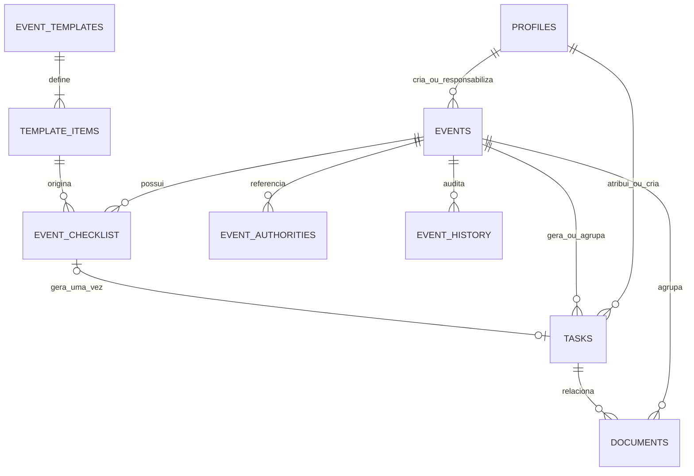

# Arquitetura de segurança — DCS HUB v0.3

## Princípios

- O DCS HUB é o sistema de registro para eventos, tarefas, checklists e contexto operacional.
- O SharePoint será o repositório primário dos arquivos Microsoft 365 **quando** a TI autorizar o conector; o DCS HUB guarda referências/relacionamentos.
- Autoridades SP permanece fonte de autoridade cadastral; não duplicar a base e não alterar sua produção.
- Supabase Auth autentica; `profiles.role` e `profiles.active` autorizam; os nomes de perfis no navegador não autorizam nada.
- Criar usuários diretamente no Supabase Auth, inicialmente inativos. A primeira promoção administrativa exige um operador confiável no SQL Editor.
- Todas as tabelas de domínio em `public` possuem RLS; operações de confirmação e reagendamento são funções controladas no servidor.

## Diagrama lógico simplificado

## Matriz de decisão

- Novo evento: usuário editor autenticado cria **pendente**; trigger cria o checklist da categoria.
- Confirmação: somente manager/admin chama `approve_event(event_id)`; transação atualiza status e cria tarefas com chave de origem única.
- Reagendamento: somente manager/admin ou criador de evento pendente; motivo registrado.
- Concluir/cancelar: apenas manager/admin na regra atual do banco.
- Tarefa avulsa: qualquer editor cria, atribui outro servidor editor ativo; autor e responsável podem atualizar.
- Exposição multidiária: início e fim `timestamptz`, data final inclusiva na visualização; não criar cópia por dia.
- Documentos: apenas metadados. Links Microsoft respeitarão permissões do SharePoint, não do DCS HUB isoladamente.
- Autoridades SP: IDs e nome exibido como snapshot, integração futura pendente de contrato autorizado.

## Testes de segurança manuais obrigatórios

1. Conta recém-criada e não ativada: login recusado pela aplicação e acesso aos dados negado pelas RLS.
2. Leitor ativo: SELECT permitido; INSERT/UPDATE/DELETE negados.
3. Servidor ativo: cria evento `pending`, mas não consegue atualizar `status` para `confirmed` diretamente nem chamar `approve_event`.
4. Gestor ativo: confirma evento; repetição retorna 0 tarefas adicionais, sem duplicação.
5. Servidor A: não consegue alterar tarefa do servidor B se não é criador ou responsável.
6. Servidor pode reagendar evento próprio pendente, mas não evento confirmado de outro responsável.
7. Documentos: links malformados ou upload sem `provider` apropriado são rejeitados por CHECK.
8. RPC e tabelas chamadas anonimamente sem sessão: retornam negado/sem registros.
9. Consulta `supabase/tests_security.sql`: todas as tabelas com RLS ligada; sem política de gravação direta no histórico.

## Diretrizes de ambiente

Use três projetos/ambientes distintos quando evoluir: desenvolvimento, homologação e produção. Não compartilhe banco, credenciais ou service role com Autoridades SP. Usuários reais, planilhas institucionais, listas de convidados, anexos e contatos só entram após aprovação da TI, políticas LGPD e auditoria de permissões.
